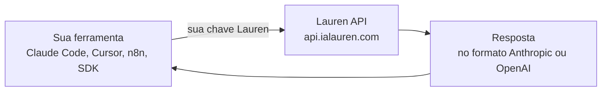

<div align="center">

<picture>
  <source media="(prefers-color-scheme: dark)" srcset="https://ialauren.com/marca/Logotexto1.png">
  <source media="(prefers-color-scheme: light)" srcset="https://ialauren.com/marca/Logotexto2.png">
  
</picture>

<br>

### Inteligência artificial em português, feita para quem trabalha com código e servidor.

<br>


<br>

[](https://ialauren.com)
[](https://api.ialauren.com)
[](https://api.ialauren.com)
[](https://api.ialauren.com/login)

</div>

<br>

## ✨ O que é a Lauren

A **Lauren** é uma plataforma brasileira de IA com dois produtos:

| | |
|---|---|
| 💬 **[Lauren IA](https://ialauren.com)** | O assistente em português. Conversa, resolve, explica e, quando você permite, **trabalha na sua máquina ou no seu servidor**: ela indica o comando, você autoriza, e tudo fica registrado. |
| 🔑 **[Lauren API](https://api.ialauren.com)** | **Claude e GPT numa chave só, por preço fixo em reais.** Sem fatura por token, sem surpresa no fim do mês, com pagamento por PIX. |

<br>

## 🚀 Por que a Lauren

<table>
<tr>
<td width="33%" valign="top">

### 🇧🇷 Feita para o Brasil
Atendimento em português, **preço em reais** e **PIX**. Sem cartão internacional, sem dólar, sem susto.

</td>
<td width="33%" valign="top">

### 💸 Preço fixo
Plano por 30 dias. **Nada de fatura por token** nem cobrança extra no fim do mês.

</td>
<td width="33%" valign="top">

### 🔌 Funciona onde você já está
Claude Code, Cursor, Cline, Codex, n8n e os SDKs da Anthropic e da OpenAI. Troque a URL e a chave.

</td>
</tr>
</table>

<br>

## 🧭 Como funciona



Você troca só a **URL base** e a **chave**. O resto do seu código e das suas ferramentas continua igual.

<br>

## ⚡ Lauren API em 30 segundos

**1.** Crie a conta em [api.ialauren.com](https://api.ialauren.com/login). O teste grátis de **30 minutos** só começa na sua primeira mensagem, e **não pede cartão**.

**2.** Copie a sua chave no painel.

**3.** Use onde você já trabalha:

```bash
curl https://api.ialauren.com/v1/messages \
  -H "x-api-key: $LAUREN_API_KEY" \
  -H "content-type: application/json" \
  -d '{
    "model": "claude-opus-5-5",
    "max_tokens": 1024,
    "messages": [{"role": "user",
      "content": "Revise esta função e aponte o bug"}]
  }'
```

**Claude Code** no terminal:

```bash
export ANTHROPIC_BASE_URL="https://api.ialauren.com"
export ANTHROPIC_AUTH_TOKEN="$LAUREN_API_KEY"
claude --model claude-opus-5-5
```

<br>

## 🧰 Funciona onde você já está

`Claude Code` · `Claude Desktop` · `Codex` · `Cline` · `Cursor` · `OpenCode` · `n8n` · `SDK Anthropic` · `SDK OpenAI`

<br>

## 💰 Planos

Todos pagos por **PIX**, em reais, e ativados na confirmação do pagamento. Sem fidelidade.

### 💬 Lauren IA · [ialauren.com](https://ialauren.com/planos)

O assistente para conversar e trabalhar, no navegador, no celular, no terminal e no VS Code.

| | **Grátis** | **PRO** | **MAX** | **ULTRA** |
|---|:---:|:---:|:---:|:---:|
| **Preço** | R$ 0 | **R$ 79,90** | **R$ 199,90** | **R$ 399,90** |
| Navegador e celular | ✅ | ✅ | ✅ | ✅ |
| Entende foto, PDF, Excel, Word e áudio | ✅ | ✅ | ✅ | ✅ |
| Terminal, Windows e VS Code | | ✅ | ✅ | ✅ |
| Faz no seu PC e na VPS | | ✅ | ✅ | ✅ |
| Modelos avançados da Lauren | | ✅ | ✅ | ✅ |
| Modelo Lauren 6 | | | ✅ | ✅ |
| Cota de Chat e Code | base | maior | quase 3× o PRO | quase 6× o PRO |
| Imagens criadas ou editadas por mês | 20 | 40 | 60 | 80 |
| Prioridade no suporte | | | ✅ | ✅ |
| Acesso antecipado às novidades | | | | ✅ |

[**Ver os planos e assinar →**](https://ialauren.com/planos)

### 🔑 Lauren API · [api.ialauren.com](https://api.ialauren.com)

Claude e GPT numa chave só, para usar nas suas ferramentas e automações. Preço fixo por **30 dias**.

| Plano | Preço |
|---|---|
| **Claude Pro** | **R$ 138,90** |
| **Claude Max** | **R$ 180,00** |
| **Claude Enterprise** | **R$ 289,90** |

> Você não recebe fatura por token nem cobrança extra no fim do mês. Teste grátis de 30 minutos, sem cartão.

[**Testar grátis →**](https://api.ialauren.com/login)

<br>

## ❓ Perguntas frequentes

<details>
<summary><b>Como funciona o teste grátis?</b></summary>
<br>
Toda conta nova ganha <b>30 minutos de teste</b>. O relógio começa na <b>primeira mensagem</b>, não no cadastro. Quando o teste acaba, a mesma chave volta a funcionar assim que você assina um plano.
</details>

<details>
<summary><b>Preciso pagar por token?</b></summary>
<br>
Não. Os planos têm <b>preço fixo por 30 dias</b>. Você não recebe fatura por token nem cobrança extra no fim do mês.
</details>

<details>
<summary><b>Posso trocar de modelo no meio do trabalho?</b></summary>
<br>
Pode. A chave dá acesso a todos os modelos do seu plano. Basta mudar o nome do modelo no app ou no pedido.
</details>

<details>
<summary><b>Como eu pago?</b></summary>
<br>
Por <b>PIX</b>. O plano é ativado assim que o pagamento é confirmado, sem precisar fazer mais nada.
</details>

<br>

## 🔒 Privacidade em primeiro lugar

- **Não guardamos o conteúdo** dos seus pedidos nem das respostas.
- **Não usamos o seu conteúdo** para treinar modelos.
- Senhas protegidas com `scrypt`; a chave pode ser trocada a qualquer momento, e a antiga para na hora.
- Tudo por HTTPS.

Leia a [Política de privacidade](https://api.ialauren.com/privacidade) e os [Termos de uso](https://api.ialauren.com/termos).

<br>

## 🇧🇷 Feito no Brasil

Atendimento em português, pagamento por PIX e preço em reais.
Dúvidas? Fale com a gente pelo [WhatsApp](https://wa.me/5511952238060). **Respondemos em até 1 hora.**

<br>

<div align="center">

**[ialauren.com](https://ialauren.com)** &nbsp;·&nbsp; **[api.ialauren.com](https://api.ialauren.com)** &nbsp;·&nbsp; **[Status](https://ialauren.com/status)**

<sub>© 2026 Lauren · Um produto Lauren IA</sub>

</div>
